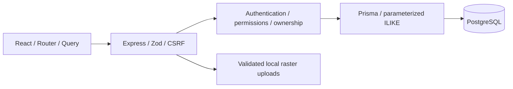
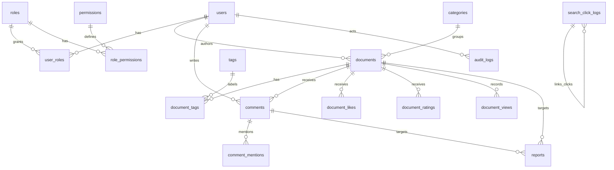

# Phase 1 architecture

Vietnamese React UI → same-origin /api/v1 → Express validation, CSRF, live database RBAC → Prisma → PostgreSQL.

Browser mutations send an X-CSRF-Token obtained from /auth/csrf. Cookies are HttpOnly, SameSite=Lax, Secure in production; session records live in PostgreSQL. Permission checks reload role relationships on every request. Responses omit password hashes and session identifiers. Public document queries always require PUBLISHED and deleted_at NULL.

API modules: auth, users, roles, documents, categories, tags, uploads, comments, engagement, reports, search, analytics, SEO, audit, settings. Shared constants define the permission matrix. SQL CHECK constraints cover rating bounds, report target exclusivity and log event shape. Administrations and associated audit writes use transactions. Pagination defaults to 10 and caps at 50.

Trade-offs: local disk uploads for coursework (production must use object storage); SQL ILIKE without ranking for Phase 1; PostgreSQL sessions avoid a separate cache service. Analytics use actual events. CI uses isolated PostgreSQL and browser tests.

## Runtime and data rules

- npm workspaces share the root lockfile. Node is bounded to 24.x. Prisma Client/CLI use 6.19.3; the root manifest defines transitive dependency overrides. The optional Linux Oxide binary must match the locked Oxide version when dependencies are upgraded.
- Search/clicks use CSRF-protected sessions for signed-in users and guests. Search metadata records ordered result IDs; click logging checks session ownership, result membership and position, then copies the stored query instead of trusting client query text.
- Views are deduplicated per browser/document in aligned UTC 30-minute buckets using a unique database key. The event and lifetime counter update atomically. Two requests on opposite sides of a bucket boundary can both count.
- Comment text edits are owner-only. Moderators use dedicated hide/restore/spam endpoints. User status, role and permission changes share a transaction-scoped PostgreSQL advisory lock to protect the last active Super Admin under concurrency. SUPER_ADMIN always retains its five core administrative permissions.
- Seeds create missing demo data and preserve existing articles, password hashes, role assignments and permission edits. They do not fabricate search/view activity. Demo articles are original educational content and covers are local original illustrations.
- Test runners accept only validated simple database names ending in `_test`, use a separate connection and do not reset or drop databases. Fresh-verification databases are retained for inspection.
- Public settings expose only siteName and commentsEnabled. Operator log retention defaults to dry-run and is not scheduled automatically. Pruning search/view events keeps audit records and lifetime view counters.

## Development and hosting

Root/API `predev` runs `scripts/prepare-dev.mjs`: it checks required ports before generating files and reuses Prisma Client when its schema, version and native engine are current. Generation runs only when needed. Vite uses strict port 5173 to match the local CSRF origin. Preparation does not migrate or seed the database; an explicit `db:generate` requires stopping an API that holds the Windows engine DLL.

Vercel serves the static frontend and proxies API/uploads/health using literal destinations in `vercel.json`. Browser requests stay on the frontend origin; Render receives the exact HTTPS WEB_ORIGIN and an explicit bounded proxy hop count (TRUST_PROXY=1 for Render, zero locally). The API binds to HOST/PORT, marks API responses no-store and separates process liveness from database readiness. Frontend-only builds need no Prisma Client or database.

The Render blueprint uses an operator-provided database and provisions no persistent disk. Its startup runs migrations and idempotent seed before the single API instance. Durable uploads require provisioned storage; multiple instances need a release job and shared rate limiting. Runtime upload ignores are anchored to `/uploads/` and `/apps/api/uploads/` so the upload source module remains tracked. See the [hosting guide](DEPLOYMENT.md).
