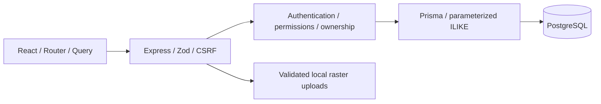
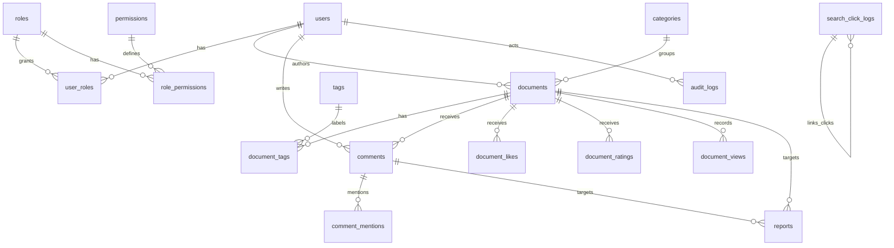

# Phase 1 architecture

Vietnamese React UI → same-origin /api/v1 → Express validation, CSRF, live database RBAC → Prisma → PostgreSQL.

Browser mutations send an X-CSRF-Token obtained from /auth/csrf. Cookies are HttpOnly, SameSite=Lax, Secure in production; session records live in PostgreSQL. Permission checks reload role relationships on every request. Responses omit password hashes and session identifiers. Public document queries always require PUBLISHED and deleted_at NULL.

API modules: auth, users, roles, documents, categories, tags, uploads, comments, engagement, reports, search, analytics, SEO, audit, settings. Shared constants define the permission matrix. SQL CHECK constraints cover rating bounds, report target exclusivity and log event shape. Administrations and associated audit writes use transactions. Pagination defaults to 10 and caps at 50.

Trade-offs: local disk uploads for coursework (production must use object storage); SQL ILIKE without ranking for Phase 1; PostgreSQL sessions avoid a separate cache service. Analytics use actual events. CI uses isolated PostgreSQL and browser tests.
